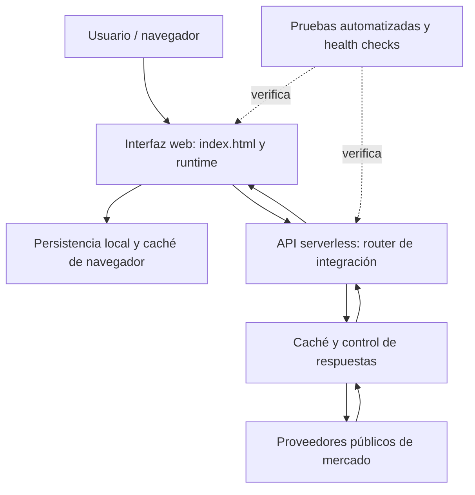

# Arquitectura de referencia — Radar Técnico G2

**Caso de ingeniería personal.** Esta nota resume la arquitectura observada en el repositorio y diferencia decisiones implementadas de garantías de operación que no se han demostrado de forma externa.

## Objetivo

Consolidar información pública de diversos mercados financieros en una experiencia web, limitando el impacto de fallos de fuentes externas sobre el análisis y la experiencia del usuario.

## Diagrama de componentes

## Decisiones de arquitectura documentadas

1. **Fachada API unificada.** `api/router.js` y rutas compatibles centralizan consultas a proveedores heterogéneos.
2. **Aislamiento de módulos.** Los archivos de `runtime/` separan dominio de mercado, cartera, renta fija, indicadores y navegación.
3. **Cachés acotadas.** El README documenta límites de memoria y caducidad; una caché reduce carga, pero no equivale a alta disponibilidad.
4. **Datos caducos como estado explícito.** Si una fuente falla, los valores anteriores no habilitan automáticamente nuevas señales de entrada o salida.
5. **QA de funcionalidades críticas.** Los scripts de pruebas comprueban navegación, integridad de datos y respuestas a fallos bajo los casos cubiertos.

## Evidencia del repositorio

- [README técnico](../README.md)
- [Pruebas de aplicación](../scripts/)
- [Workflows automatizados](../.github/workflows/)
- [API serverless](../api/)

## Límites conocidos

El proyecto depende de cuotas y disponibilidad de servicios de terceros. La persistencia de algunas configuraciones y carteras es local al navegador; no debe presentarse como sincronización multi-dispositivo. Un workflow exitoso no constituye por sí solo una auditoría de seguridad o una garantía de disponibilidad.

**Enfoque profesional:** integración de plataformas, controles operacionales, gestión de proveedores y diseño para fallos previsibles.
